## operaciones basicas con open cv 
# Alumna _Alejandra Rivera NC = 0200
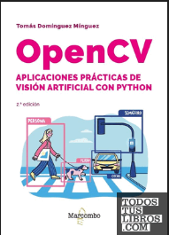
# LECTURA DE LA IMAGEN DESDE LA CARPETA 
## Cuando no puede cargar la imagen 
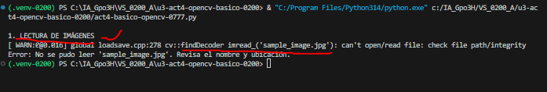
## Cuando puede leer la imagen 
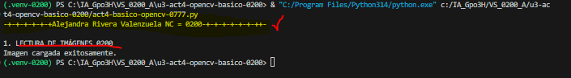
## Resultado
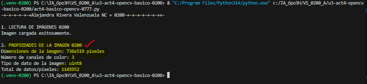
## Mostrando Imagen original 
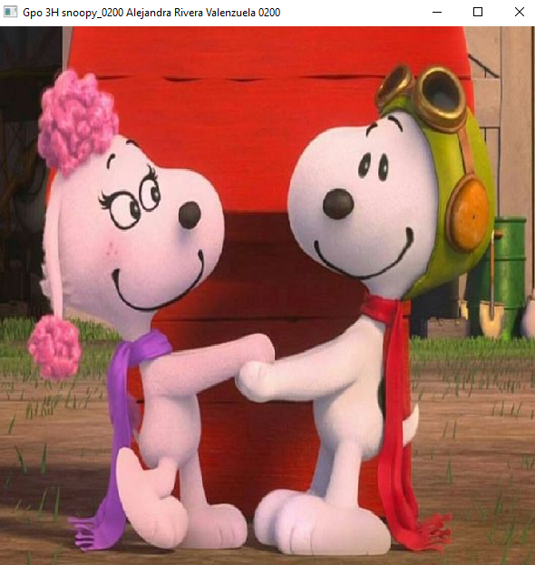
# En  la terminal 
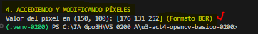
# 1. LECTURA DE LA IMAGEN DESDE LA CARPETA
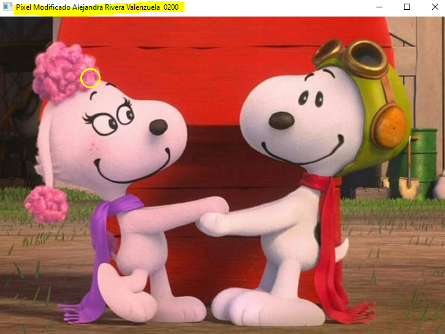
# 2. PROPIEDADES DE LA IMAGEN
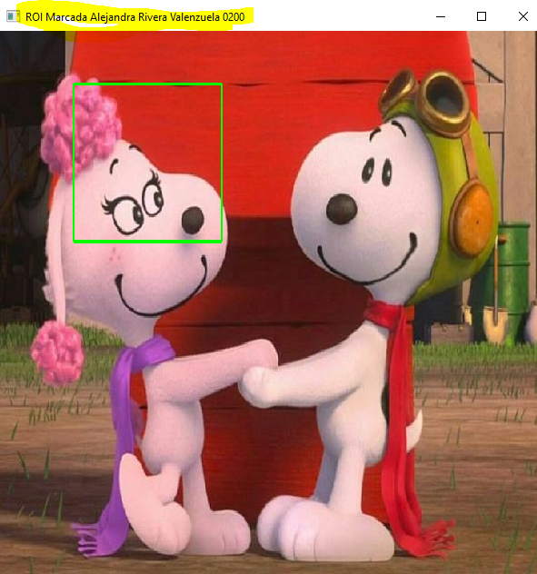
# 3. VISUALIZACIÓN DE LA IMAGEN ORIGINAL
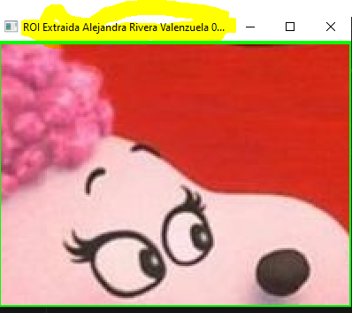
# 4. ACCESO Y MODIFICACIÓN DE PÍXELES INDIVIDUALES
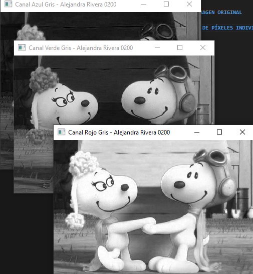
# 6. SEPARACIÓN Y FUSIÓN DE CANALES DE COLOR (BGR)
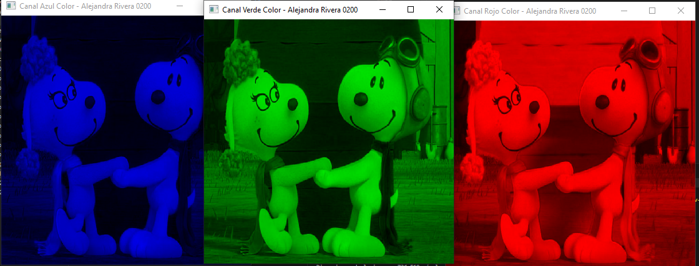
# 5. REGIÓN DE INTERÉS (ROI - REGION OF INTEREST)
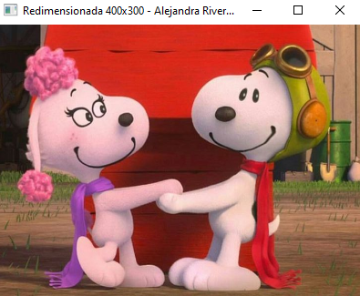
# 6. SEPARACIÓN Y FUSIÓN DE CANALES DE COLOR (BGR)
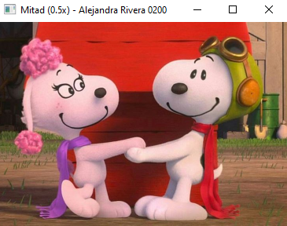
# 7. REDIMENSIONAMIENTO DE IMÁGENES (RESIZING)
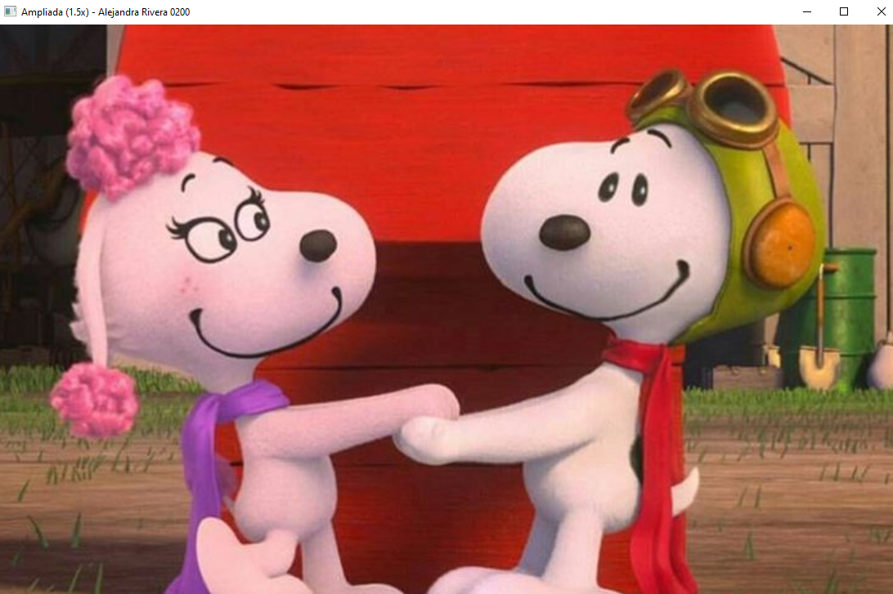
# 8. ROTACIÓN DE IMÁGENES
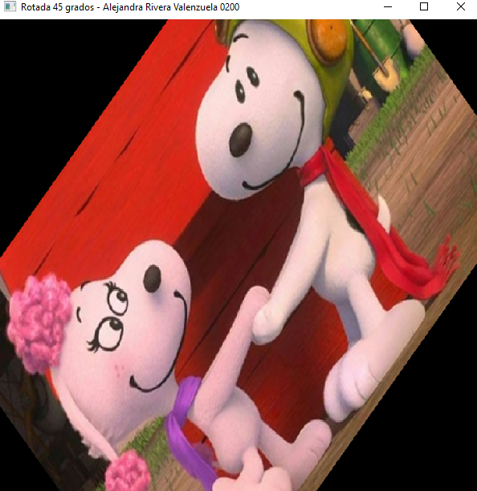
# 8. ROTACIÓN DE IMÁGENES
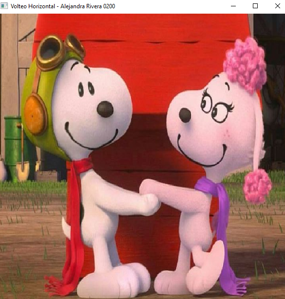
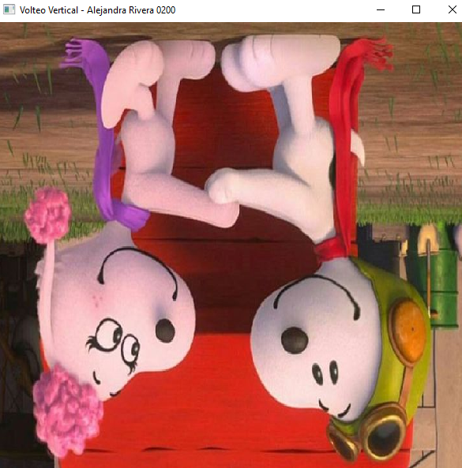
# 10. GUARDADO DE RESULTADOS Y LIMPIEZA
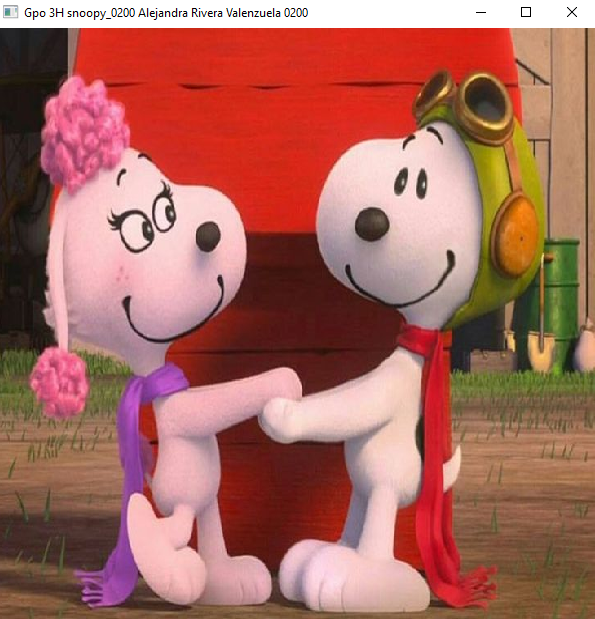